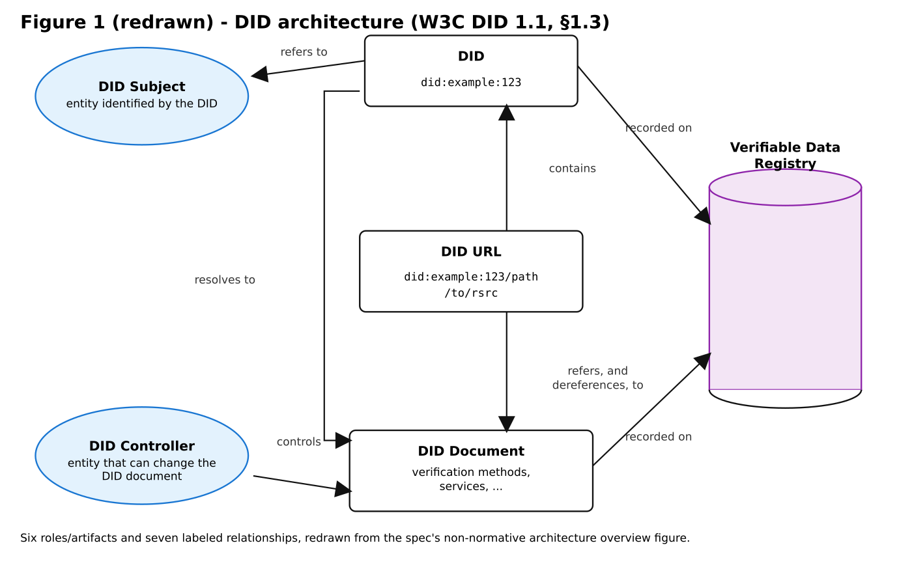
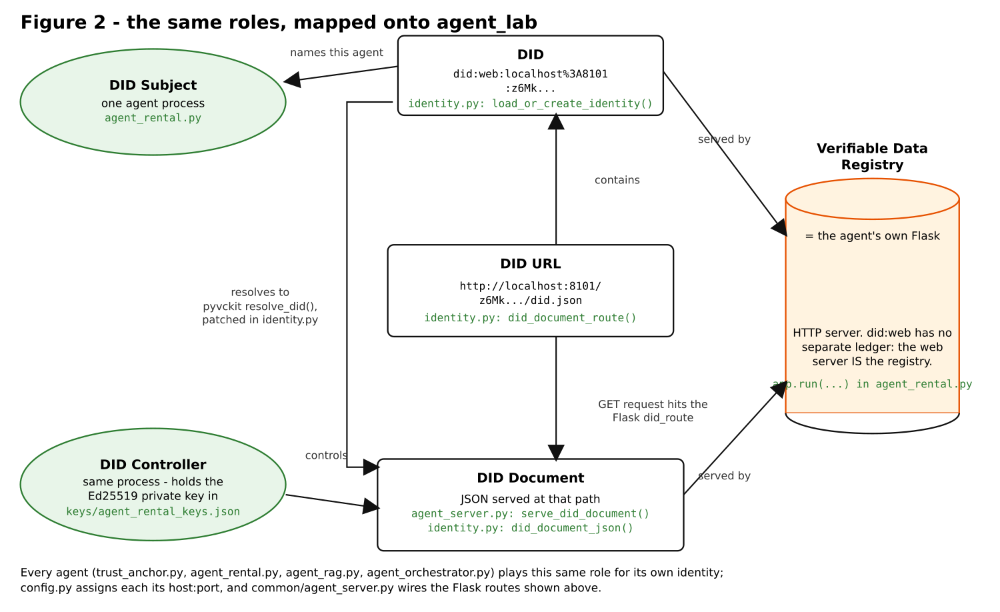

# Brief introduction to DID and VC

This lab's trust framework (section 3 of the [README](README.md)) is built
on two W3C standards:

* **Decentralized Identifiers (DID)** - [W3C DID 1.1](https://www.w3.org/TR/did-1.1/)
* **Verifiable Credentials (VC)** - [W3C VC Data Model 2.0](https://www.w3.org/TR/vc-data-model-2.0/)

Neither spec is agent-specific - both are general identity/credentialing
standards, used here for agent-to-agent trust instead of their more common
use cases (people, organizations, physical products). This note maps each
spec's own vocabulary directly onto the Python files in this repo, so you
can read the spec and the code side by side.

## Decentralized Identifiers applied in the agent_lab

A DID is just a URI that resolves to a **DID document** - a small JSON
document listing (among other things) the public keys that can be used to
authenticate the DID's owner. Unlike, say, an X.509 certificate, there's no
central certificate authority: *how* a DID resolves to its document is
defined per **DID method** (`did:web`, `did:key`, `did:ion`, ...), and this
lab uses `did:web` - the simplest method, where the DID is literally
derived from a domain name and resolving it is just an HTTPS GET.

### Figure 1, redrawn

The spec's own architecture overview ([DID 1.1, §1.3](https://www.w3.org/TR/did-1.1/#architecture-overview))
introduces six roles/artifacts and the relationships between them:

<p align="center">

</p>

* **DID Subject** - the entity identified by the DID.
* **DID Controller** - the entity with the capability to make changes to
  the DID document (often, but not always, the same as the subject).
* **DID** - the identifier itself, e.g. `did:example:123`.
* **DID URL** - a DID plus a path/query/fragment, identifying a specific
  resource, e.g. a particular key or service inside the document.
* **DID Document** - what the DID resolves to: verification methods,
  services, etc.
* **Verifiable Data Registry** - "a system that facilitates the creation,
  verification, updating, and/or deactivation of DIDs and DID documents"
  ([DID 1.1, terminology](https://www.w3.org/TR/did-1.1/#dfn-verifiable-data-registry)) -
  a blockchain for some DID methods, a plain web server for `did:web`.

### Figure 2 - the same roles, mapped onto agent_lab

<p align="center">

</p>

Every process in this lab that has an identity - `trust_anchor.py`,
`agent_rental.py`, `agent_rag.py`, and `agent_orchestrator.py` - plays
*all four* of DID Subject, DID Controller, DID, and DID Document for
itself: each one generates its own keypair, derives its own DID from it,
and serves its own document. There's no separate registration authority;
identity creation is entirely local and unsupervised - the first time a
process runs, `load_or_create_identity()` mints a fresh keypair and DID for
it with no network call at all (see `common/identity.py`). The trust
anchor never approves or even sees this step; it only gets involved later,
when it issues a *credential about* an already-existing DID (§3.3).

### Where DIDs appear in the code

| Role / operation | File(s) | What happens |
|---|---|---|
| Generate keypair + derive DID (Subject *and* Controller, self-issued) | `common/identity.py` - `load_or_create_identity()` | First run: `generate_keys()` + `generate_did()` (pyvckit), persisted to `keys/<name>_keys.json`. Later runs: reload the same keys, re-derive the same DID. |
| Compute the DID URL a document must be served at | `common/identity.py` - `did_document_route()` | This `pyvckit` `did:web` variant doesn't resolve to `/.well-known/did.json`; it derives the actual path from the DID's own key hash. |
| Build the DID document body | `common/identity.py` - `did_document_json()` | Wraps `pyvckit.did.gen_did_document()`. |
| Serve the DID document (be a Verifiable Data Registry) | `trust_anchor.py`; `common/agent_server.py` - `serve_did_document()` | A plain Flask `GET` route at the computed DID URL path. For `did:web`, this *is* the whole registry - no ledger. |
| Resolve a peer's DID (consume the registry) | `common/identity.py` - `_patch_resolve_did_url()` patches `pyvckit.did.resolve_did_url`; invoked internally by `verify_signature()` | `did:web` resolution needs a percent-decoding fix for ports (`localhost%3A8101` &rarr; `localhost:8101`) to actually work locally - see the patch's docstring. |
| Declare "this is my DID" to a caller | `common/agent_server.py` - `serve_agent_card()` (`securitySchemes.didAuth.did`) | Read by `agent_orchestrator.py`'s `discover()` and by `extension_proof_of_possession.py`. |
| An agent's own identity, held for future use (mutual auth extension) | `agent_orchestrator.py` - `Orchestrator.__init__` | The orchestrator has a DID too, currently unused in the base flow. |
| Prove control of the *private* key behind a DID (not just assert it) | `extension_proof_of_possession.py` / `extension_proof_of_possession_solution.py`; `common/identity.py` - `issue_self_signed_proof()`; `common/agent_server.py` - `POST /prove` | Section 4's extension - closes the gap that DID documents/agent cards are just copyable public files. |

## Verifiable Credentials applied in the agent_lab

A Verifiable Credential is a set of claims made by an **issuer** about a
**credential subject**, cryptographically signed so a **verifier** can
check it hasn't been tampered with and really was issued by that issuer.
This lab defines its own custom credential type, `AgentCapabilityCredential`
- "the trust anchor certifies that DID X is allowed to perform capability
Y" - which is exactly the [`credentialSubject`](https://www.w3.org/TR/vc-data-model-2.0/#credential-subject)
extensibility the spec is designed around: the base spec doesn't know
anything about "capabilities," but its data model lets you define your own
claims, as long as your `@context` maps them (see the `@vocab` note below).

### Roles, mapped onto agent_lab

| VC role/concept | agent_lab equivalent | File(s) |
|---|---|---|
| **Issuer** | The trust anchor | `issue_credentials.py`, `common/identity.py` - `issue_capability_credential()` |
| **Credential subject** | A capability agent (rental-agent / rag-agent) | `credentialSubject.id` in the issued VC |
| **Verifiable Credential** | The `AgentCapabilityCredential` itself | `credentials/agent_rental.json`, `credentials/agent_rag.json` (generated, not committed) |
| **Holder** | Each agent, serving its own credential | `common/agent_server.py` - `serve_credential()` (`GET /credential.json`) |
| **Verifier / relying party** | The orchestrator, before every `/invoke` call | `agent_orchestrator.py` - `Orchestrator.call_agent()`, via `common/identity.py` - `verify_capability_credential()` |
| **Proof / securing mechanism** | An `Ed25519Signature2018` linked-data signature | `pyvckit.sign.sign()` / `pyvckit.verify.verify_signature()` |

Note what's *not* used here: there's no [Verifiable Presentation](https://www.w3.org/TR/vc-data-model-2.0/#presentations)
wrapper - agents just serve their raw credential directly at
`/credential.json` rather than presenting it inside a signed envelope of
their own. That's a simplification for the lab, not a spec requirement.

### A real issued credential

```json
{
  "@context": [
    "https://www.w3.org/ns/credentials/v2",
    { "@vocab": "https://agents-lab.pti.example/vocab#" }
  ],
  "id": "urn:uuid:1055a220-9591-4820-835a-afc910ccbabc",
  "type": ["VerifiableCredential", "AgentCapabilityCredential"],
  "issuer": { "id": "did:web:localhost%3A8100:z6MkhBqZSnnsfdZekEuWXBGfnd3KnkecpzmDgkSn6qfegXgk" },
  "validFrom": "2026-07-11T14:42:26Z",
  "credentialSubject": {
    "id": "did:web:localhost%3A8101:z6MkexE7FbfnxQezWgAXZnGB1Vv6nurhNJsnPeJCFceSjKFz",
    "name": "rental-agent",
    "capabilities": ["list_rentals"]
  },
  "proof": {
    "type": "Ed25519Signature2018",
    "proofPurpose": "assertionMethod",
    "verificationMethod": "did:web:localhost%3A8100:z6MkhBqZSnnsfdZekEuWXBGfnd3KnkecpzmDgkSn6qfegXgk#z6MkhBqZSnnsfdZekEuWXBGfnd3KnkecpzmDgkSn6qfegXgk",
    "created": "2026-07-11T14:42:26Z",
    "jws": "eyJhbGciOiJFZERTQSIsImNyaXQiOlsiYjY0Il0sImI2NCI6ZmFsc2V9..tA8f3uXchUkKGIL6WvTXZAw8YlpVQGUn1tV8A3TnqbNUhLIH62pJ7qDGgPuWYkTKgljR3I-ZBO42xW_HUvhdBA"
  }
}
```

The `@context`'s second entry (`@vocab`) is what makes this lab's custom
fields - `capabilities`, `name`, and the self-signed proof's `nonce` -
actually **covered by the signature**. The base VC context has no mapping
for them; without the `@vocab` fallback, JSON-LD expansion would silently
*drop* unmapped fields before the signature is even computed, and
tampering with them would go completely undetected. See the README's
[§3.4](README.md#34-trust-checked-routing) for the full field-by-field walkthrough of
`verify_capability_credential()`'s four checks (signature, trusted issuer,
subject match, capability listed) against this exact credential.

### Spec-compliance note

This credential's shape (`@context` starting with
`https://www.w3.org/ns/credentials/v2`, `validFrom` rather than
`issuanceDate`) matches every structural **MUST** in VC 2.0. The one gap:
`common/agent_server.py`'s `/credential.json` route serves it with
`Content-Type: application/json` rather than the spec-registered
`application/vc` (or `application/vc+ld+json`) media type - a transport
detail, not a change to the JSON itself.
