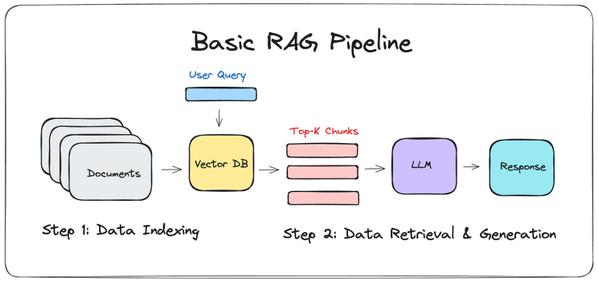
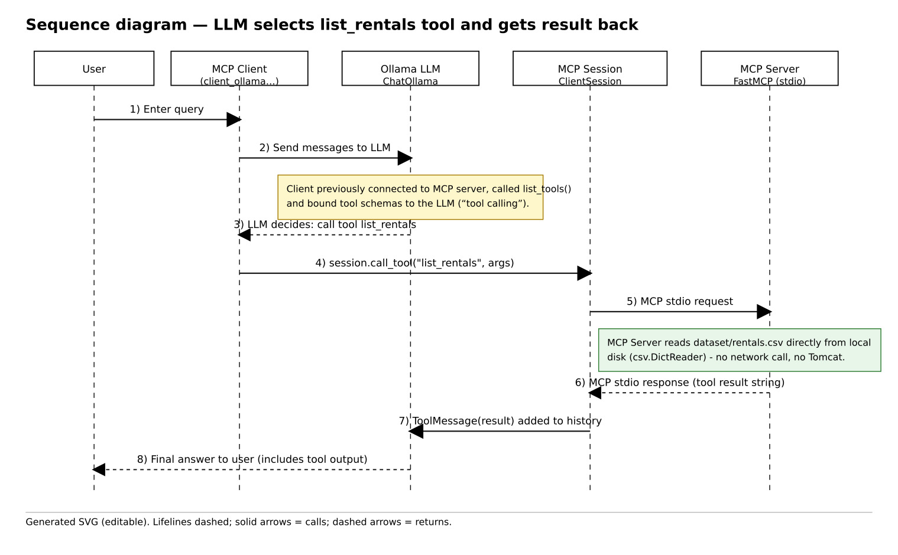

# A network of trusted AI agents

## Introduction

In this lab we build a **small network of AI agents** that run locally, talk to each other over plain HTTP, and use a **DID/Verifiable Credential trust framework** to decide whether to trust one another.

You will:

1. Build a **RAG chatbot** (Retrieval-Augmented Generation) for a car rental dataset (section 1). **Required.**
2. Build a chatbot that uses **MCP** (Model Context Protocol) to call an external tool (section 2). **Required.**
3. Turn those two capabilities into standalone **agents**, each with its own cryptographic identity (a `did:web` Decentralized Identifier (DID)) and a signed **Verifiable Credential** (VC) certifying what it's allowed to do, and build an **orchestrator** that only calls a peer agent after verifying its credential (section 3). **Required.**
4. Extend the network so agents can prove they actually control the private key behind their DID, not just assert it (section 4). **Optional.**
5. Pick a further self-proposed extension (section 5). **Optional.**

## Required core vs. optional extensions

This lab split into a **required core (sections 0-3)** and
**optional extensions (sections 4-5)**. 

Sections 1 and 2 provide a first contact with RAG and MCP. They're self-contained and mostly run as given.
Section 3 is a mix of running provided scripts and inspecting what they produce. The part of "What the four checks actually mean" inside 3.4, you can treat it as background reading.

Section 4 is a code extension, and section 5 is an open-ended extension. Both are **optional**.  

### Why not a full framework like A2A or ANP?

Two open agent-interoperability efforts are worth knowing about: [A2A](https://a2a-protocol.org/) (Agent2Agent, Linux Foundation) defines an **agent card** (a JSON manifest of an agent's skills, published at
`/.well-known/agent-card.json`) plus a full JSON-RPC task/messaging protocol. [ANP](https://github.com/agent-network-protocol/AgentNetworkProtocol)
(Agent Network Protocol) proposes DID-based agent identity and JSON-LD capability documents. That is conceptually very close to what we build here. We borrow A2A's **agent card shape** (real field names: `skills`, `capabilities`, `securitySchemes`, ...) because it gives us the right vocabulary, but we do *not* use A2A's full task protocol or rely on ANP's (still immature) tooling.

## 0. Preparing the environment

Install [Ollama](https://github.com/ollama/ollama) if you haven't already:

    curl -fsSL https://ollama.com/install.sh | sh
    ollama run llama3.2
    ollama pull nomic-embed-text

The second pull is a dedicated **embedding** model, used by section 1's
`create_index.py` - `llama3.2` is a chat model and cannot be used to compute embeddings (asking Ollama to do so fails with *"This server does not support embeddings"*).

We can check that the models are now available locally:

    ollama list

Sections 1 and 2 each use their own Python virtual environment.
Section 3 (and its extension in section 4) uses one more virtual environment, `envagentslab`, created inside `agents_lab/`:

    python3 -m venv envagentslab
    source envagentslab/bin/activate
    pip install -r requirements.txt

`pip` may print a couple of "yanked version" warnings for
`langchain-ollama`/`langchain-community` - safe to ignore, these are the
exact versions section 1 already relies on.

## 1. Chatbot with RAG (3 points)

Go into **`chatbot-car_rental/`** and **follow the README there.** 

Just as a summary what we do in **`chatbot-car_rental/`**:

You create and activate its virtual environment and install its requirements:

    cd chatbot-car_rental
    python3 -m venv envchatbotcarrental
    source envchatbotcarrental/bin/activate
    pip3 install -r requirements.txt

We use **Retrieval-Augmented Generation (RAG)** to give the local LLM
access to external knowledge - here, the `dataset/rentals.csv` file - that
it wasn't trained on.

<p align="center">

</p>

We run the indexer once:

    python3 create_index.py

This creates `saved_index/vector_index_llama3_2_rentals.pkl` - **section 3
reuses this file**, so don't delete it.

Then we run the interactive chatbot:

    python3 query_index.py

We try the default query: *Can you check which engine types have a low rating?*

#### Experimenting

- Measure how long indexing/querying take with different Ollama models.
- Compare answer quality across models.
- Convert `rentals.csv` to an enriched `rentals.pdf` and adapt
  `create_index.py`/`query_index.py` to use it.
- Compare RAG vs. non-RAG answers to the same question.
- One self-proposed test of your choice.

Include your files, screenshots, and comments in the lab report.

`cd ..` **back to `agents_lab/`** when you're done.

## 2. Chatbot with MCP (3 points)

Go into **`chatbot_mcp/`**, create and activate its virtual environment and
install its requirements:

    cd chatbot_mcp
    python3 -m venv envchatbot_mcp
    source envchatbot_mcp/bin/activate
    pip3 install -r requirements.txt

As a summary what we do in the **`chatbot_mcp/`**: With MCP, the chatbot (Ollama) has external "tools" it can call. The MCP
server (`server_mcp.py`) registers a `list_rentals` tool that reads the
same `dataset/rentals.csv` used in section 1, plus two weather tools
(`get_alerts`, `get_forecast`) as unrelated examples. The MCP client
(`client_mcp.py`) connects to Ollama and to the MCP server, tells Ollama
which tools exist, and relays Ollama's tool calls to the server.

*RAG vs MCP?* Section 1's index is a snapshot taken at indexing time. With
MCP, the chatbot retrieves "live" information through a tool call instead.

We run the client, pointing it at the server script:

    python3 client_mcp.py server_mcp.py

We should see the three tools `['list_rentals', 'get_alerts',
'get_forecast']` listed. We can ask something like *which rental had the highest
number of days?* and confirm `list_rentals` gets called.

<p align="center">

</p>


### Self-proposed extension

Some ideas: get the weather tool selected by asking about weather in a
city; swap in a different local tool; or your own idea. Explain the
motivation, run it, and report it.

`cd ..` **back to `agents_lab/`** when you're done.

## 3. A network of trusted agents (4 points)

We now turn the two capabilities above into standalone **agents** - separate processes, each on its own port, each with its own DID, each carrying a credential that says what it's allowed to do. (a quick introduction to Decentralized Identifiers (DIDs) and Verifiable Credentials (VCs) can be found [here)](./Brief_introduction_to_DID_and_VC.md)

| Process | Port | Role |
|---|---|---|
| `trust_anchor.py` | 8100 | The identity every agent's credential is checked against. Serves only its own `did.json`. |
| `agent_rental.py` | 8101 | Offers `list_rentals` as MCP tool. |
| `agent_rag.py` | 8102 | Offers `rag_query`, reusing the vector index built in section 1. |
| `agent_orchestrator.py` | 8103 | The "front door" - the process you talk to. Discovers the other agents, verifies their credentials, and routes your questions to the right one. |

Make sure you're in **`agents_lab/`** with `envagentslab` active for the rest of this lab. Remember to activate it with

    source envagentslab/bin/activate


### 3.1 Identities

Every agent generates (once) or loads (on later runs) its own Ed25519 keypair and a `did:web` identifier, using `common/identity.py`. Start the trust anchor:

    python3 trust_anchor.py

Leave it running in its **own terminal**. It prints its own DID, something like
`did:web:localhost%3A8100:z6Mk...`, and the URL it's actually serving the
document at. 

Run curl to get the DID document. (complete it with the exact path is printed by trust_anchor.py on startup)

    curl http://localhost:8100/z6Mk.../did.json

Look at the returned document. It's the standard `did:web` document shape:
a `verificationMethod` carrying the public key, referenced from
`authentication`/`assertionMethod`.

The full DID specification, a W3C standard, can be found [here](https://www.w3.org/TR/did-1.1/).

**Two local-network workarounds since we deploy DIDs in `localhost` and `http://`, both does not correspond to the default situation. 
(both handled for you in `common/identity.py`, but worth commenting they exist):

1. A `did:web` identifier can encode a domain with a port, percent-encoded as `%3A` (e.g. `did:web:example.com%3A8443:...`). A DID resolver converts this into `https://example.com:8443/...`. The customized [`pyvckit`](https://pypi.org/project/pyvckit/) version we use here, however, builds that resolution URL from the DID string *without* decoding the `%3A` back into a real colon, which breaks the typical resolution for any `did:web` identity that includes a port, but this is what we need for our situation with four agents on four local ports.
2. This `pyvckit` variant also never resolves to `/.well-known/did.json` the way you might expect from the did:web spec: it always treats the key's multibase hash (the last segment of the DID) as a *URL path* segment too, e.g. `did:web:localhost%3A8101:z6Mk...` resolves to
   `http://localhost:8101/z6Mk.../did.json`. `did_document_route()` in
   `common/identity.py` derives the right Flask route from this
   automatically. That's why the URL trust_anchor.py prints looks longer than you might expect.

`common/identity.py` patches issue (1) once, at import time (see the comment at the top of `_patch_resolve_did_url`), and works with (2) rather than against it (see `did_document_route`). This is a  local-development workaround since DID resolvers expect a `https://` production domain.

### 3.2 Agent cards

Start the two capability agents (**separate terminals**, `envagentslab` active in each):

    python3 agent_rental.py
    python3 agent_rag.py      # needs section 1's saved_index/ to already exist

Check that each one serves an **agent card** at a well-known path, borrowing real
[A2A](https://a2a-protocol.org/) field names:

    curl http://localhost:8101/.well-known/agent-card.json

Have a look at the `skills` array, the JSON Schema for its arguments, and `securitySchemes.didAuth.did` (the DID it claims to be).
That agent card indicates what the agent can do.
Note that the agent card is not yet signed and anything can be written there. 
Right now, nothing stops an agent from *claiming* any DID it likes in its card. Section 4 addresses that gap.

### 3.3 Issuing capability credentials

The trust anchor now issues each agent a signed **AgentCapabilityCredential**. That credential is issued as **[Verifiable Credential](https://www.w3.org/TR/vc-data-model-2.0/) (VC)**, a format defined by the W3C. lists which capability that agent's DID is certified for. (you can run the command from another terminal, make sure the env is active)

    python3 issue_credentials.py

This writes `credentials/agent_rental.json` and `credentials/agent_rag.json`.
Open one and look at its shape: `issuer.id` (the trust anchor's DID),
`credentialSubject.id` (the agent's DID), `credentialSubject.capabilities`,
and a `proof.jws` (the actual signature).

Check that each agent serves its own credential, e.g.:

    curl http://localhost:8101/credential.json


Check that the credential is issued by the trust anchor.

### 3.4 Trust-checked routing

We want to check what DID and VC-enabled system provides.

Start the orchestrator in another terminal:

    python3 agent_orchestrator.py

On startup it fetches every agent's card, and prints what it discovered.
Then ask it something (on modest hardware, expect the answer to take up to a minute or so). The orchestrator makes two LLM calls per query, one to decide which tool to call and one to turn the tool's result into an answer, and the second one is doing more work; it hasn't hung):

    Query: list the current car rentals

Watch the terminal output: before calling `agent_rental`'s `/invoke`, the
orchestrator fetches its credential and runs `verify_capability_credential`
(`common/identity.py`) - checking the signature, that the issuer is the trust anchor it's configured to trust, that the credential's subject DID matches the DID the agent actually claims in its card, and that the capability being requested is actually listed. Only if all four checks
pass does it call `/invoke`. Now ask a RAG-style question:

    Query: which engine types have a low rating?

Confirm this one routes to `agent_rag` instead, using section 1's index.

**Now break it on purpose.** Stop `agent_rental.py`, hand-edit
`credentials/agent_rental.json` (e.g. change `"list_rentals"` to
`"list_everything"` in `credentialSubject.capabilities`, or just flip one character inside `proof.jws`), restart `agent_rental.py`, and ask the orchestrator a rentals question again. It should refuse the call and print
why. Identify the actual security property the trust framework provides.

> **Recommended reading from here to the end of 3.4 (optional).** The rest
> of this subsection explains *why* the tampering above gets caught. Read
> it if you want to understand the mechanics well enough. 
> If you want to go now into these details is optional.

*(Start of the optional-reading block)*

*Why does tampering get caught?* Verifiable Credential signatures cover a
normalized RDF graph of the credential, produced via JSON-LD. The standard
VC context has no mapping for fields like `capabilities`; without a
fallback, JSON-LD expansion would silently **drop** unmapped fields before
the graph is even built - meaning they'd never be covered by the signature
in the first place, and tampering with them would go completely
undetected. `common/identity.py`'s `LAB_CONTEXT` adds an `"@vocab"` fallback
specifically to prevent this. This is a real, easy-to-miss VC pitfall
worth remembering if you ever design your own credential schema: *a field
your JSON-LD context doesn't map is a field your signature doesn't
protect.*

#### What the four checks actually mean

Here's an actual `credentials/agent_rental.json`, to map the explanation
below onto real fields:

```json
{
  "@context": [
    "https://www.w3.org/ns/credentials/v2",
    { "@vocab": "https://agents-lab.pti.example/vocab#" }
  ],
  "id": "urn:uuid:1055a220-9591-4820-835a-afc910ccbabc",
  "type": ["VerifiableCredential", "AgentCapabilityCredential"],
  "issuer": {
    "id": "did:web:localhost%3A8100:z6MkhBqZSnnsfdZekEuWXBGfnd3KnkecpzmDgkSn6qfegXgk"
  },
  "validFrom": "2026-07-11T14:42:26Z",
  "credentialSubject": {
    "id": "did:web:localhost%3A8101:z6MkexE7FbfnxQezWgAXZnGB1Vv6nurhNJsnPeJCFceSjKFz",
    "name": "rental-agent",
    "capabilities": ["list_rentals"]
  },
  "proof": {
    "type": "Ed25519Signature2018",
    "proofPurpose": "assertionMethod",
    "verificationMethod": "did:web:localhost%3A8100:z6MkhBqZSnnsfdZekEuWXBGfnd3KnkecpzmDgkSn6qfegXgk#z6MkhBqZSnnsfdZekEuWXBGfnd3KnkecpzmDgkSn6qfegXgk",
    "created": "2026-07-11T14:42:26Z",
    "jws": "eyJhbGciOiJFZERTQSIsImNyaXQiOlsiYjY0Il0sImI2NCI6ZmFsc2V9..tA8f3uXchUkKGIL6WvTXZAw8YlpVQGUn1tV8A3TnqbNUhLIH62pJ7qDGgPuWYkTKgljR3I-ZBO42xW_HUvhdBA"
  }
}
```

1. **Signature validity** - `proof.verificationMethod`
   (`did:web:...8100:...#z6Mk...`) tells the verifier whose key to check
   against: it resolves that `did:web` (the trust anchor's), pulls its
   Ed25519 public key from the resolved document, and checks whether
   `proof.jws` is a valid signature over a normalized hash of the whole
   document. Change *any* field afterward - flip `"list_rentals"` to
   `"list_everything"`, or point `credentialSubject.id` at a different
   agent - and the hash no longer matches what was signed. This answers
   *"is this document exactly what its signer signed, unmodified?"*

2. **Trusted issuer** - `issuer.id` (`did:web:...8100:...`, the trust
   anchor) must equal the DID the verifier is itself configured to trust
   (loaded from its own local `trust_anchor_keys.json`, never taken from
   the credential). Check 1 only proves *someone* with a real key signed
   this; it says nothing about whether that someone is worth trusting -
   anyone could mint their own throwaway DID and validly self-sign a
   credential claiming rental-agent has any capability they like. This
   answers *"was this signed by the one authority I trust, not just by
   some valid signer?"*

3. **Subject DID match** - `credentialSubject.id`
   (`did:web:...8101:...`, rental-agent's own DID) must equal the DID that
   *this specific agent* claims for itself in its own
   `/.well-known/agent-card.json`. A credential is just a static, copyable
   JSON file - a different, malicious server could serve up a byte-for-byte
   copy of rental-agent's real, validly-signed credential while actually
   being a different agent entirely. This check catches "you're presenting
   a credential that isn't about the party I'm talking to"; it's still not
   the same as proving you *are* that party, which is exactly the gap
   section 4's proof-of-possession extension closes.

4. **Capability listed** - `credentialSubject.capabilities`
   (`["list_rentals"]`) must contain the specific capability being
   invoked. Even a credential that's genuine, from the right issuer, and
   about the right agent only authorizes what it explicitly lists - this
   one says nothing about, say, `rag_query`. This answers *"is this agent
   actually certified for the specific thing I'm about to ask it to do?"*

All four must pass, in order - each closes a gap the previous ones leave
open: a valid signature does not imply a trustworthy issuer; a trustworthy
issuer does not imply the credential is about the party you're talking to;
and being about the right party does not imply it's authorized for this
particular action.

*(End of the optional-reading block - the required part of section 3 is done. Move on to section 4 only if you want. It's optional.)*

## 4. Optional extension: proof-of-possession 

Right now, `verify_capability_credential` checks that a credential is
validly signed and correctly issued - but never checks that the agent
you're actually talking to over HTTP is the one the credential and card
describe. Nothing today stops an impostor from copying someone else's
`did.json`, `agent-card.json` and `credential.json` onto its own server.

Every agent already exposes `POST /prove`: send it a nonce, and it signs a
small self-issued credential over that nonce with its own private key
(`issue_self_signed_proof` in `common/identity.py`, already implemented).

Open `extension_proof_of_possession.py` and complete `verify_proof()` - the
docstring lists the four checks you need (signature validity, that the
proof is self-issued by the claimed DID, that the subject matches too, and
that the nonce matches the one you sent - that last check is what stops an
attacker from replaying a proof they captured for a different challenge).
It directly mirrors `verify_capability_credential`, which you've already
read in section 3.

With `trust_anchor.py` and `agent_rental.py` running, test it:

    python3 extension_proof_of_possession.py rental-agent

Confirm it prints `PASS`. Then break it on purpose again: modify your
script to check the response against a *different* nonce than the one you
sent, and confirm it now correctly prints `FAIL`. Report both.

## 5. Optional: self-proposed extension

Pick one (or propose your own), explain the motivation, run it, and report
it:

- Add a fourth agent with a new capability, get it a credential from the
  trust anchor, and have the orchestrator route to it.
- Implement credential **revocation**: give the trust anchor a way to mark
  a credential revoked, and make `verify_capability_credential` check it.
- Add `validFrom`/`validUntil` to issued credentials and make
  `verify_capability_credential` reject expired ones.
- Mutual authentication: the orchestrator has its own DID too
  (`config.ORCHESTRATOR_PORT`, generated in `agent_orchestrator.py`) - make
  `agent_rental.py`/`agent_rag.py` require proof of the *caller's* identity
  before answering, not just trust any request that arrives at `/invoke`.

## 6. Reporting / Submission

You need to upload the following files to your GDrive's lab group folder
before the next lab session:

* A tarball containing the source files (including this whole
  `agents_lab/` folder, but excluding the `env*` virtual environment
  folders and the generated `keys/`/`credentials/` files).
* A .pdf with a report describing the steps taken to complete the **required core (sections 0-3)**, including screenshots of the application output.
* If your group attempted section 4 and/or section 5 (optional), add their results as extra sections in the same report.
