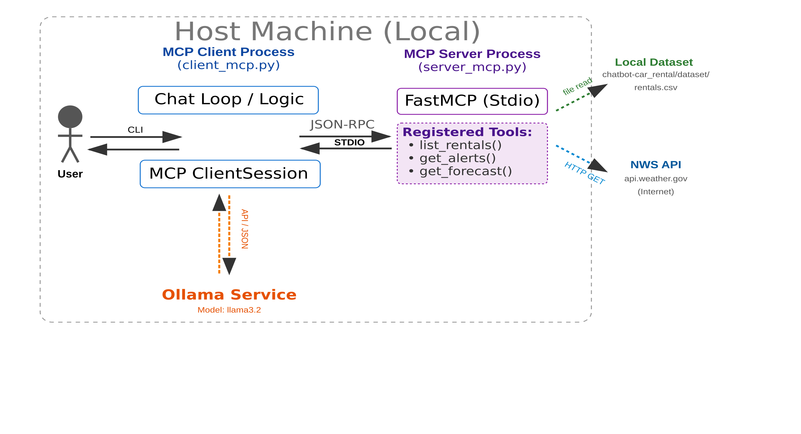

# Creating a chatbot with MCP for the car rental shop

## 1 Introduction

We will build a **chatbot using MCP (Model Context Protocol)** for which we take code from this [page](https://modelcontextprotocol.io/). Specifically, we will customize the [MCP client example](https://modelcontextprotocol.io/docs/develop/build-client) and the [MCP server example](https://modelcontextprotocol.io/docs/develop/build-server).


The scenario is the following:

<p align="center">

</p>

## 2 Preparing the environment

We will work with a virtual Python environment. Being in the folder `chatbot_mcp`, create the virtual environment called `envchatbotmcp`:

    python3 -m venv envchatbot_mcp

It will create a folder with that same name in your local directory.

Activate the virtual environment with: 

    source envchatbot_mcp/bin/activate

After activating you will see (envchatbot_mcp) added to your current command line in your terminal.

The existing chatbot code needs several packages to be installed. The packages are listed in the `requirements.txt` file. 

Install the packages with pip3:

    pip3 install -r requirements.txt
    

With MCP, the chatbot (Ollama) will have external "tools" available which it can ask for further information. To make Ollama aware of the car rentals, we register a `list_rentals` tool in the MCP server that reads the `rentals.csv` dataset (the same one used in the RAG section) directly from disk. The MCP client will read the available tools from the server, tell them to Ollama, and Ollama can select a suitable one and make requests about the car rentals.


***RAG vs MCP?***
With the previous section with RAG, the chatbot was supplied with information from the index. That index was created at a certain moment in time and may have become outdated (or we update the index). With MCP, the chatbot can retrieve "live" information (through tools), such as the information about the current list of rentals.


<!--- --->


### LLM model  

(if you have done the previous part, you can skip this, since Ollama is already installed)

As Large Language Models (LLM), we use models from [Ollama](https://github.com/ollama/ollama).


Install Ollama

    curl -fsSL https://ollama.com/install.sh | sh

In Ollama's [git](https://github.com/ollama/ollama) repository, you can see the available models. It is suggested to download the small models llama3.2:1b, llama3.2, and llama3.1, if possible. If your computer has good RAM and GPU capacities, you may also try larger models. 


    ollama run llama3.2

    ollama run llama3.2:1b
       
    ollama run llama3.1
    
We can check that the models are now available locally:

    ollama list
 
### MCP server

Check the `server_mcp.py` file (you don't have to modify it for running it).
The key ingedient is the [mcp package](https://pypi.org/project/mcp/).
For this example, we run the MCP server locally. It communiates with the MCP client over *stdio*. (It is also possible to prepare the MCP server to be "remote", but it can be a bit more complex to set that up)
 
```py
...
# Initialize FastMCP server
mcp = FastMCP("pti")
...
def main():
    # Initialize and run the server
    mcp.run(transport="stdio")
```

The MCP server code has a section to indicate the "tools". The tools can be local or remote. Here, `list_rentals` is a local tool that just reads the CSV file:

```py
RENTALS_CSV = os.path.join(
    os.path.dirname(os.path.abspath(__file__)),
    "..", "chatbot-car_rental", "dataset", "rentals.csv",
)

@mcp.tool()
async def list_rentals(userid: str = "") -> str:
    """Fetch the current car rental list from the local dataset.

    Args:
        userid: kept for interface compatibility with the original tool signature; unused
    """
    with open(RENTALS_CSV, newline="") as f:
        rows = list(csv.DictReader(f))

    lines = [", ".join(f"{k}={v}" for k, v in row.items()) for row in rows]
    return "\n".join(lines)
```


### MCP client

Check the `client_mcp.py.` file (you don't have to modify it for running it).
The client first connects to Ollama and to the MCP server. 
It "orchestrates" the conversation between the local LLM (Ollama) and the MCP server providing the tools.
The capacity of the MCP server is that it knows how to talk with each of the tools (API. format of request and response, ...).
Ollama selects the tool but cannot interact directly with it, for this it has the MCP server.
After having done the initialization, the code that contains the MCP client awaits for a user input.


## 3 Testing

No external server needs to be started - `list_rentals` reads `../chatbot-car_rental/dataset/rentals.csv` directly, so as long as that file is there (it ships with the repo) you're ready to go.

Regarding the MCP client and server (no need to make changes to the files), indicating the file name of the server, run

    python3 client_mcp.py server_mcp.py

We should see in the terminal output the three tools ['list_rentals', 'get_alerts', 'get_forecast']

Now we make a query asking about the car rentals, trying that the `list_rentals` tool is used.
(for example:  which rental had the highest number of days?)

Are the terminal outputs matching the following sequence diagram?

<p align="center">

</p>

Analyze the answer that you obtain.

## 4 Self-proposed extension

Conduct an interesting additional test or modification of your choice. Explain the motivation, run and report it.
Just some ideas: 
1. There is another tool in the MCP server, it should be selected if we ask something like *"what is the weather in New York"*. 
2. Ask something like *"are there any weather alerts in Texas?"* or *"any severe weather warnings for California?"* to trigger the `get_alerts` tool instead. (since it only needs a two-letter US state code rather than exact latitude/longitude, it sidesteps the coordinate-accuracy issues small local models have with `get_forecast`). Does the model pick the right tool?.
3. Replace it by another tool, or add another (local) tool? 
4. Your idea.

## 5 Reporting

Include your files, screenshots of results and comments in the lab report.
